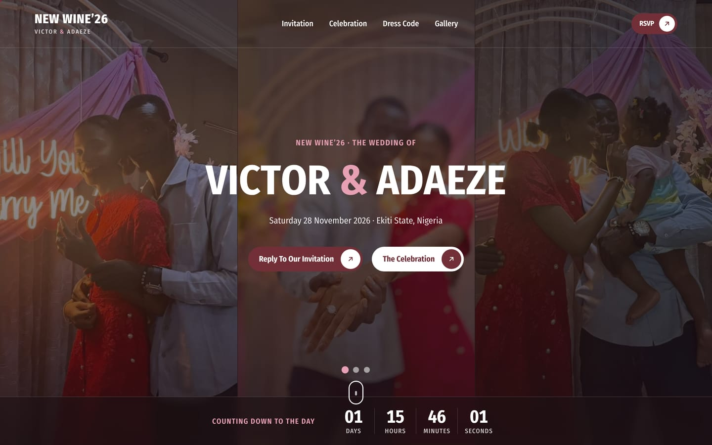

# Design: NEW WINE'26

The wedding of Victor & Adaeze, Saturday 28 November 2026, Ekiti State.

## Reference

The couple chose **[revivalhubinternational.org](https://revivalhubinternational.org/)** as the design template: its font, its colour handling, its animation, everything.

That site is built on *Avenix*, a commercial church HTML template by Awaiken. The template's code is licensed to that site, so none of its CSS, JavaScript or images is copied here. Everything below was rebuilt from scratch to reproduce the same design language: the same open-source typeface, the same kinds of component and the same motion, measured from the live site.

## Colour

The couple's colours: wine, burgundy and green for the traditional engagement; white and grey for the white wedding; pink and purple.

| Role | Colour | Where |
|---|---|---|
| Accent (the reference's red) | Wine `#722F37` | buttons, two-tone headings, labels, call-to-action bands, the ticker, date badges |
| Hover and deep tone | Burgundy `#800020`, deep wine `#4F1C25` | draft flags, the closing band, page headers |
| Dark (the reference's black) | Ink `#1C1014`, near-black with a wine undertone | headings, the sticky header, the footer, the lightbox |
| Light accent | Pink `#E8A0B4` | the ampersand, labels on dark backgrounds, slider dots, the ticker icons |
| Tints | Blush `#FBF0F3`, mist `#F6F4F5` | alternate sections, cards, form fields |
| Event colours | Green `#1F5A3D`, white, grey `#A7A6AB`, purple `#6B3E8E` | the stripe across each event card, the dress-code swatches, "open to all" tags |

Every text colour pair meets WCAG AA. Body text is `#4F474B` on white.

The dress-code section shows the colours as themes: traditional engagement, white wedding, and pink & purple. The last theme has no title until the couple say which celebration it belongs to. Each event card carries a stripe of its own colours. All colours are defined once at the top of `content/wedding.js`.

## Type

**Fira Sans Condensed** (SIL Open Font License, self-hosted) is the reference's only typeface, as it is here.

| Element | Setting |
|---|---|
| Headings | 700 weight, uppercase, 44 px for sections and up to 84 px in the hero |
| Section labels | 600 weight, 16 px, uppercase, in wine with an icon |
| Body | 400 weight, 16 px, line height 1.6 |
| Navigation | 500 weight, 16 px |

Headings are two-tone: "THE **CELEBRATION**", "OUR **COLOURS**". Extended-Latin subsets load only when a Yoruba or Igbo name needs them.

## Components, as on the reference

- **Header:** transparent over the hero, with white links and a hairline. Past 200 px it tucks away; past 600 px it slides back in as a solid ink bar.
- **Hero:** a full-screen slider (sliding, one second, every five seconds) under a dark overlay. It has a huge uppercase headline, two pill buttons, dots, a mouse scroll cue, and a translucent bottom strip, which here holds the countdown.
  - The couple's photos are portrait, so on wide screens they sit side by side as panels, and the current slide's panel brightens. On phones one photo fills the screen and crossfades.
- **Pill buttons:** they end in a white disc with an arrow. On hover, ink floods in from the left and the arrow turns.
- **Ticker:** a wine band of uppercase words scrolling continuously: NEW WINE'26, the names, the date, the tagline.
- **Invitation:** two overlapping photographs with one sweeping rounded corner, and a round date badge.
- **Wine call-to-action band:** a hand-drawn arrow pointing at a white pill button.
- **Cards:** rounded corners of 30 px, on blush or white: event cards, colour themes, guest information, gifts.
- **Footer:** ink, with the wordmark, quick links, contacts and a reply button.
- **Inner pages:** a photo band with the page title and breadcrumb, then a white card.

## Motion

| Effect | Reference (GSAP / WOW.js) | Here (own code) |
|---|---|---|
| Headings | SplitText: characters slide 20 px from the right and fade, 1 s, 0.03 s stagger, ease-out, at 85 % of the viewport | The same, with grapheme-safe splitting so letters such as ọ́ stay whole. Long lines split by word. |
| Images | A curtain wipe: the frame slides in while the photo counter-slides, 1 s | The same, with CSS keyframes |
| Blocks | `fadeInUp` with 0.25, 0.5 and 0.75 s delays | Fade up 50 px with the same delays |
| Image hover | A diagonal white shine | The same |
| Slider | Swiper, sliding, 1 s | Own slider: sliding, 1 s, swipe, dots, pauses on hover, focus or a hidden tab |
| Parallax | parallaxie | The closing photograph drifts at a gentle rate on large screens |
| Cursor | A custom cursor | A dot with a trailing ring that grows over links. Mouse devices only. |
| Preloader | A full-screen colour with a spinner | Wine with the wordmark. It clears as the page loads and gives up after 1.6 s, so it never blocks the page. |

Reduced-motion settings switch all of this off. Everything works without JavaScript.

## Earlier direction

The site was first designed in a quieter "Harmattan" direction: Newsreader with Hanken Grotesk, bone paper and a laterite accent. That direction is kept for reference in [`design/directions.html`](design/directions.html), and the couple's chosen template replaces it.
